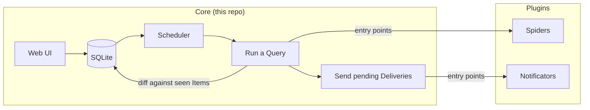

# Listing Watch

**A self-hosted web app that watches classifieds and listings sites on a schedule and notifies you the moment something new appears.**

[](https://github.com/jprevc/listing-watch/actions/workflows/main.yml)
[](https://pypi.org/project/listing-watch/)
[](https://hub.docker.com/r/josprevc/listing-watch)
[](https://www.python.org/downloads/)
[](https://opensource.org/licenses/MIT)


You set up a **Query**: a site to watch, how often to check it, and where to send alerts. On every run, a
**Spider** crawls the site, the new **Items** are diffed against everything already seen, and only the new
ones are sent to your **Notification Profiles** (ntfy, Pushover, Email). Spiders and Notificators are
installed as Plugins, so adding a site means writing a small Python package, not changing the app.

## Try it in one command

The repo includes a self-contained demo: a fake classifieds site that posts a new listing every 2 minutes,
a [demo Spider Plugin](demo/plugin) that crawls it, and a local [ntfy](https://ntfy.sh) server to receive
the alerts. You need only Docker.

```bash
git clone https://github.com/jprevc/listing-watch.git
cd listing-watch
docker compose up --build
```

| Open                                        | To see                                                      |
|---------------------------------------------|-------------------------------------------------------------|
| http://localhost:8000 (sign in `demo`/`demo`) | Listing Watch, with two Queries already set up              |
| http://localhost:8080/listing-watch-demo    | The notifications arriving                                   |
| http://localhost:8001                       | The fake classifieds site being watched                      |

The first run finds the listings already posted. After that, each new listing reaches ntfy within a
minute of being posted. `docker compose down -v` resets everything.

<table>
  <tr>
    <td></td>
    <td></td>
  </tr>
  <tr>
    <td></td>
    <td></td>
  </tr>
</table>

## Features

- **Per-Query schedules**: a simple interval or a cron expression, or manual runs only. "Run now" and
  "Stop" work on any Query.
- **Reliable delivery**: an Item is never lost because a notification failed. It stays pending and goes
  out with the next run (see [ADR-0002](docs/adr/0002-track-delivery-per-item-and-profile.md)).
- **Failing alerts**: a Query whose crawl fails 3 runs in a row alerts its Notification Profiles once, and
  again when it recovers, so a broken Spider doesn't go unnoticed.
- **Plugins for sites and channels**: Spiders and Notificators are discovered through Python entry points.
  The settings each one needs are rendered as form fields in the web UI.
- **Multi-user**: everyone on a shared instance has their own Queries and Notification Profiles.
- **Responsive UI** with light and dark themes, built with Django, htmx, Alpine.js and Tailwind.

<p align="center">
  
  &nbsp;
  
</p>

## Architecture



The Core is the web UI, the scheduler and the Plugin interface. It ships no Spiders and no Notificators,
and never imports a concrete one. Everything is discovered at runtime through the `listing_watch.spiders`
and `listing_watch.notificators` entry-point groups. The public [notificators](https://github.com/jprevc/listing-watch-notificators)
Plugin provides ntfy, Pushover and Email. The Spiders for real sites live in a private Plugin
([ADR-0001](docs/adr/0001-split-core-spiders-notificators.md) explains why), which is why this repo comes
with a demo instead.

### Engineering notes

- **Plugin contract.** [`listing_watch.contract.check_plugin`](listing_watch/contract.py) lets a Plugin check
  itself against the Core's interface from its own tests. A Query or Notification Profile whose Plugin
  isn't installed is kept and shown as *Unavailable*, never deleted.
- **One Delivery per Item and Profile.** Overlapping runs of the same Query (a "Run now" during a scheduled
  run) claim pending Deliveries with a single conditional `UPDATE`, so nothing is sent twice. Claims left
  by a run that died expire after 15 minutes.
- **SQLite under concurrent writers.** The web workers and the scheduler process write the same database.
  WAL mode, `IMMEDIATE` transactions and a long busy timeout fixed a bug where "database is locked" once
  silently killed APScheduler's thread (see [`settings.py`](webui/webui/settings.py)).
- **Stopping a crawl safely.** A Spider can run a headless browser on a greenlet-driven event loop, where
  Django ORM calls aren't allowed. The "Stop" signal is polled on a separate thread and handed to the
  Spider as a plain flag.
- **Docs for decisions, not just code.** [ADRs](docs/adr), a domain glossary ([CONTEXT.md](CONTEXT.md)) and a
  [changelog](CHANGELOG.md).
- **CI/CD.** Tests, mypy and pylint run on every push. Tagged releases publish to PyPI and Docker Hub.

## Writing a Spider Plugin

[`demo/plugin`](demo/plugin) is a complete, standard-library-only example. A Plugin is an ordinary Python
package that depends on `listing-watch>=4,<5`:

1. Subclass **`listing_watch.spiders.Spider`**, set its `name`, and implement `run()` so it returns
   Item dicts. Every Item needs a `title` and a `url`; `price` is optional, and extra keys are allowed.
   List the keys in `item_fields` so they can be used as placeholders in **`message_body_format`**.
2. Declare any settings the Spider needs from the user as `config_fields`; the Query form renders them.
3. Register the class in your `pyproject.toml`:

   ```toml
   [project.entry-points."listing_watch.spiders"]
   cars = "my_plugin.spiders:CarsSpider"
   ```

4. Check it against the Plugin interface from your tests with
   `listing_watch.contract.check_plugin("my-plugin")`.

The public Docker image has no Spiders. To deploy, build an image `FROM` it that installs your Spider
Plugin, plus anything its Spiders need (e.g. a browser). [`demo/Dockerfile`](demo/Dockerfile) does exactly
that.

## Notification configuration

Notificators also come from Plugins. The Docker image includes
[`listing-watch-notificators`](https://github.com/jprevc/listing-watch-notificators), which provides
**Email** (Gmail SMTP), **Pushover** and **ntfy**; see its README for how to set each one up. For a local
install, add it next to the Core:

```bash
uv pip install "listing-watch-notificators>=1,<2"
```

Each Notificator is set up once as a reusable **Notification Profile** under "Notification profiles", then
attached to any Query. Mark a profile as default for its type to have it pre-selected whenever you add a
Query. Profiles are private to the account that created them.

## Running without Docker

```bash
uv sync --group web --group dev
uv pip install "listing-watch-notificators>=1,<2"   # Notificators come from a Plugin
uv pip install <your Spider Plugin>                  # and so do Spiders, e.g. ./demo/plugin
cd webui
python manage.py migrate
python manage.py createsuperuser

python manage.py runserver        # web UI, in one terminal
python manage.py runscheduler     # cron-driven scheduler, in another terminal
```

Visit `http://localhost:8000/`.

## Development

```bash
uv sync --group web --group dev
uv run pytest
```

The demo Plugin has its own tests:

```bash
uv pip install -e ./demo/plugin
uv run --no-sync pytest demo/plugin/tests --no-cov
```
