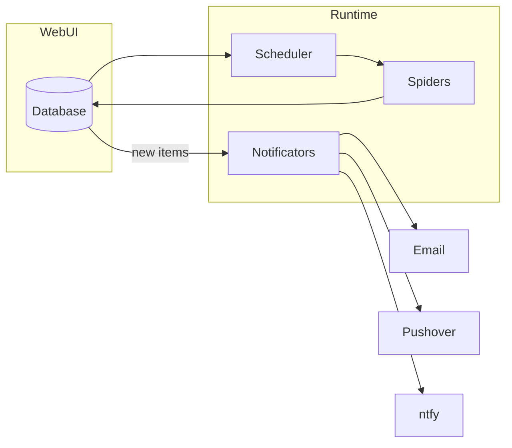

# Listing Watch

**An extensible Python web crawler framework that monitors listings/classifieds sites for new items and sends notifications via Email, Pushover, or ntfy.**

[](https://github.com/jprevc/listing-watch/actions/workflows/main.yml)
[](https://www.python.org/downloads/)
[](https://opensource.org/licenses/MIT)
[](https://pypi.org/project/listing-watch/)

## Overview

Listing Watch runs spiders that crawl configured websites (e.g. classifieds, car listings) for new items. When new content is found, it alerts you via Email (Gmail SMTP), Pushover, or ntfy. Everything — which sites to watch, how often, and where to send notifications — is configured through the [Web UI](#web-ui), a Django app backed by a database (no config files, no legacy JSON cache).

## Features

- **Scheduling** — Run each query on a simple interval or a cron expression, configured per query in the web UI.
- **Multiple notificators** — Email (Gmail), Pushover, and ntfy; mix and match per query with configurable message formats.
- **Extensible spiders** — Add custom spiders in `spiders.py`; each yields items whose keys match your `message_body_format` placeholders.
- **Web UI** — Manage queries and schedules, trigger manual runs, and browse found items and run history in a browser.
- **Dockerized** — Suitable for containerized deployment (images published on Docker Hub).

## Architecture



Flow: queries, schedules, and notification profiles are configured in the web UI and stored in the database. The scheduler triggers each query on its configured schedule. Spiders fetch pages and parse items, which are diffed against previously found items already stored in the database. New items trigger notifications via that query's configured channels.

## Notification configuration

Three notification backends are supported: **Email** (Gmail SMTP), **Pushover**, and **ntfy**. Each is set up once as a reusable **notification profile** in the web UI (see [Web UI](#web-ui)), then attached to any query.

### Email

1. Create an [App Password](https://myaccount.google.com/apppasswords) for your Gmail account.
2. Enter the username and password into an email notification profile.

### Pushover

1. Sign up at [Pushover](https://pushover.net/signup) and note your **user token**.
2. Register your app at [Pushover Apps](https://pushover.net/apps/build) and get an **API token**.
3. Enter the user token(s) and API token into a Pushover notification profile.
4. Install the [Pushover app](https://pushover.net/) on your device(s) to receive notifications.

Trial expires after 30 days; a one-time purchase is required to continue. See [Pushover pricing](https://pushover.net/pricing).

- [Android](https://play.google.com/store/apps/details?id=net.superblock.pushover)
- [App Store](https://apps.apple.com/us/app/pushover-notifications/id506088175)

### ntfy

1. Pick a topic name (a unique, unguessable string) on the public [ntfy.sh](https://ntfy.sh/) service, or run your own [self-hosted ntfy server](https://docs.ntfy.sh/install/).
2. Subscribe to that topic in the [ntfy app](https://ntfy.sh/#subscribe) (Android/iOS/web) or CLI to receive notifications.
3. Configure the notification profile with `topic` (required), and optionally `server` (defaults to `https://ntfy.sh`), `priority`, `tags`, and authentication (`token`, or `username`+`password` for a protected topic/self-hosted server).

## Adding custom spiders

1. Open **`listing_watch/spiders.py`**.
2. Add a class that subclasses **`Spider`**.
3. Implement crawling so the spider **yields** item dicts. The keys of each dict must match the placeholders used in the **`message_body_format`** strings in your notification profiles (e.g. `query`, `url`, `price`).

## Web UI

A Django-based web UI lives in `webui/`. It lets you add and configure queries (URL + spider + cron schedule + notifications) from a browser, trigger manual runs, and browse found items and run history (via Django admin). It uses a SQLite database instead of the legacy JSON cache files.

Notification credentials (ntfy topic/token, Pushover app token, email login) are set up once as a reusable **notification profile** under "Notification profiles" in the web UI, then attached to any query -- no need to re-enter them for every new query. Mark a profile as default for its type to have it auto-attached (pre-selected, still removable) whenever you add a query. Profiles are private to the account that created them.

`exampleSpider` drives a real headless browser via Playwright (example.com's anti-bot protection
requires actual JS execution), so its browser binary needs a one-time separate install:

```bash
playwright install chromium
```

```bash
uv sync --group web --group dev
cd webui
python manage.py migrate
python manage.py createsuperuser

python manage.py runserver        # web UI, in one terminal
python manage.py runscheduler     # cron-driven scheduler, in another terminal
```

Visit `http://localhost:8000/` for the query list, and `http://localhost:8000/admin/` for found items and run history.

## Development setup

Clone the repository:

```bash
git clone https://github.com/jprevc/listing-watch.git
cd listing-watch
```

Install in development mode (with dev dependencies) and run tests:

```bash
uv sync --extra dev
uv run pytest
```
