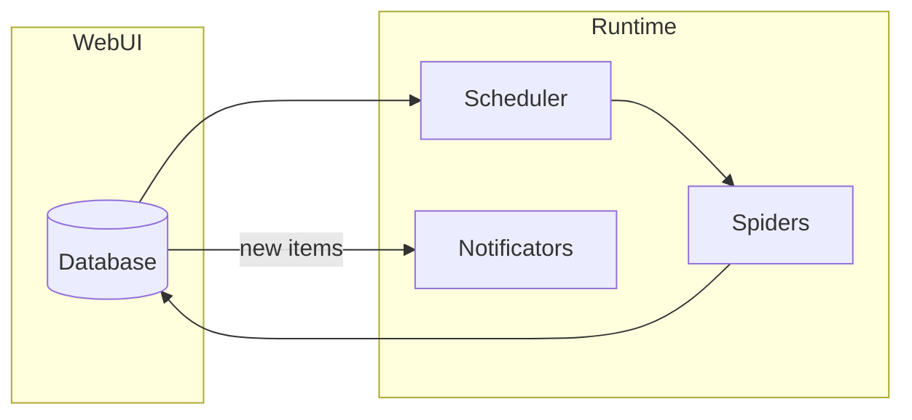

# Listing Watch

**An extensible Python framework that watches listings/classifieds sites for new items and sends notifications through pluggable Notificators.**

[](https://github.com/jprevc/listing-watch/actions/workflows/main.yml)
[](https://www.python.org/downloads/)
[](https://opensource.org/licenses/MIT)
[](https://pypi.org/project/listing-watch/)

## Overview

Listing Watch runs spiders that crawl configured websites (e.g. classifieds, car listings) for new items. When new content is found, it alerts you through the Notificators installed from Plugins (e.g. Email, Pushover or ntfy from [`listing-watch-notificators`](https://github.com/jprevc/listing-watch-notificators)). Everything — which sites to watch, how often, and where to send notifications — is configured through the [Web UI](#web-ui), a Django app backed by a database (no config files, no legacy JSON cache).

## Features

- **Scheduling** — Run each query on a simple interval or a cron expression, configured per query in the web UI.
- **Pluggable notificators** — Install Notificator Plugins (the Docker image ships [`listing-watch-notificators`](https://github.com/jprevc/listing-watch-notificators): Email, Pushover and ntfy); mix and match per query with configurable message formats.
- **Extensible spiders** — Add custom spiders in `spiders.py`; each yields items whose keys match your `message_body_format` placeholders.
- **Web UI** — Manage queries and schedules, trigger manual runs, and browse found items and run history in a browser.
- **Dockerized** — Suitable for containerized deployment (images published on Docker Hub).

## Architecture



Flow: queries, schedules, and notification profiles are configured in the web UI and stored in the database. The scheduler triggers each query on its configured schedule. Spiders fetch pages and parse items, which are diffed against previously found items already stored in the database. New items trigger notifications via that query's configured channels.

## Notification configuration

The Core contains no Notificators of its own: they come from Plugins, registered through the
`listing_watch.notificators` entry-point group. The public Docker image includes
[`listing-watch-notificators`](https://github.com/jprevc/listing-watch-notificators), which provides
**Email** (Gmail SMTP), **Pushover** and **ntfy** -- see its README for how to set each one up. For a
local install, add it next to the Core:

```bash
uv pip install "listing-watch-notificators>=1,<2"
```

Each Notificator is set up once as a reusable **notification profile** in the web UI (see [Web UI](#web-ui)), then attached to any query.

## Adding custom spiders

1. Open **`listing_watch/spiders.py`**.
2. Add a class that subclasses **`Spider`**.
3. Implement crawling so the spider **yields** item dicts. The keys of each dict must match the placeholders used in the **`message_body_format`** strings in your notification profiles (e.g. `query`, `url`, `price`).

## Web UI

A Django-based web UI lives in `webui/`. It lets you add and configure queries (URL + spider + cron schedule + notifications) from a browser, trigger manual runs, and browse found items and run history (via Django admin). It uses a SQLite database instead of the legacy JSON cache files.

Notification credentials (e.g. an ntfy topic or a Pushover app token) are set up once as a reusable **notification profile** under "Notification profiles" in the web UI, then attached to any query -- no need to re-enter them for every new query. Mark a profile as default for its type to have it auto-attached (pre-selected, still removable) whenever you add a query. Profiles are private to the account that created them.

`exampleSpider` drives a real headless browser via Playwright (example.com's anti-bot protection
requires actual JS execution), so its browser binary needs a one-time separate install:

```bash
playwright install chromium
```

```bash
uv sync --group web --group dev
uv pip install "listing-watch-notificators>=1,<2"   # Notificators come from a Plugin
cd webui
python manage.py migrate
python manage.py createsuperuser

python manage.py runserver        # web UI, in one terminal
python manage.py runscheduler     # cron-driven scheduler, in another terminal
```

Visit `http://localhost:8000/` for the query list, and `http://localhost:8000/admin/` for found items and run history.

## Development setup

Clone the repository:

```bash
git clone https://github.com/jprevc/listing-watch.git
cd listing-watch
```

Install in development mode (with dev dependencies) and run tests:

```bash
uv sync --extra dev
uv run pytest
```
