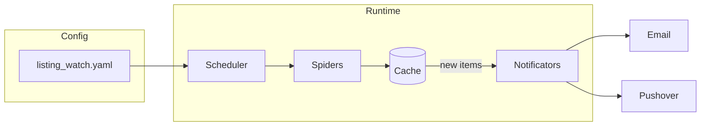

# Listing Watch

**An extensible Python web crawler framework that monitors listings/classifieds sites for new items and sends notifications via Email, Pushover, or ntfy.**

[](https://github.com/jprevc/listing-watch/actions/workflows/main.yml)
[](https://www.python.org/downloads/)
[](https://opensource.org/licenses/MIT)
[](https://pypi.org/project/listing-watch/)

## Overview

Listing Watch runs spiders that crawl configured websites (e.g. classifieds, car listings) for new items. When new content is found, it alerts you via Email (Gmail SMTP), Pushover, or ntfy. You can run crawlers once or on a schedule, and extend the framework with custom spiders. A Django-based web UI (see [Web UI](#web-ui) below) is also available for managing queries, schedules, and notifications, and for browsing found items and run history, backed by a database instead of the legacy JSON cache files.

## Features

- **Scheduling** — Run crawlers periodically (e.g. every 15 minutes) via a `schedule` section in config, or via cron expressions per query in the web UI.
- **Multiple notificators** — Email (Gmail), Pushover, and ntfy; mix and match per spider/query with configurable message formats.
- **Extensible spiders** — Add custom spiders in `spiders.py`; each yields items whose keys match your `message_body_format` placeholders.
- **Web UI** — Manage queries and schedules, trigger manual runs, and browse found items and run history in a browser.
- **Dockerized** — Suitable for containerized deployment (images published on Docker Hub).

## Architecture



Flow: configuration is read from `listing_watch.yaml`. The scheduler (if configured) runs the spiders at the specified interval. Spiders fetch pages, parse items, and check the cache for already-seen entries. New items trigger notifications via the configured channels (Email and/or Pushover).

## Installation

Install from PyPI:

```bash
python -m pip install listing-watch
```

`exampleSpider` drives a real headless browser via Playwright (example.com's anti-bot protection
requires actual JS execution), so its browser binary needs a one-time separate install:

```bash
playwright install chromium
```

Run from the CLI and view help:

```bash
python -m listing_watch -h
```

## Configuration

Configuration is defined in a **`listing_watch.yaml`** file.

### Config file path

Pass the path via CLI:

```bash
python -m listing_watch -c /path/to/listing_watch.yaml
```

If not provided, the app looks for the file in a `config` directory (if present) and in the current working directory.

### Cache location

When a spider runs, it stores seen items in a `.nc_cache` directory. Override the default location with:

```bash
python -m listing_watch --cache /path/to/data
```

If not specified, the cache is stored in `data/.nc_cache` relative to the current working directory.

### Spiders and URLs

In the config file, define a **`spiders`** section listing each spider and its settings. Example:

```yaml
spiders:
  example:
    notifications:
      email:
        email_user: "you@gmail.com"
        email_password: "your-app-password"
        recipients: ['jost.prevc@gmail.com']
        message_body_format: "Query: {query}\nURL: {url}\nPrice: {price}\n"
      pushover:
        recipients: ['ukdwndomjog3swwos57umfydpsa2sk']
        send_separately: True
        message_body_format: "Query: {query}\nPrice: {price}\n"
    urls:
      'pet_prijateljev': https://example.com/?ctl=search_ads&keywords=pet+prijateljev
      'enid_blyton': https://example.com/?ctl=search_ads&keywords=enid%20blyton
```

- The spider key (e.g. `example`) must match the **`name`** attribute of a spider class in `listing_watch/spiders.py`.
- Each spider must have **`notifications`** and **`urls`**. Notifications define how you are alerted when new items are found for the given URLs. Secret values (passwords, tokens) go directly in the config -- there is no environment-variable indirection.

### Schedule

To run crawlers on a schedule, add a **`schedule`** section:

```yaml
schedule:
  every: 15
  units: minutes
```

### Example full config

```yaml
schedule:
  every: 15
  units: minutes
spiders:
  example:
    notifications:
      email:
        email_user: "you@gmail.com"
        email_password: "your-app-password"
        recipients: ['jost.prevc@gmail.com']
        message_body_format: "Query: {query}\nURL: {url}\nPrice: {price}\n"
      pushover:
        recipients: ['ukdwndomjog3swwos57umfydpsa2sk']
        send_separately: True
        message_body_format: "Query: {query}\nPrice: {price}\n"
    urls:
      'pet_prijateljev': https://example.com/?ctl=search_ads&keywords=pet+prijateljev
      'enid_blyton': https://example.com/?ctl=search_ads&keywords=enid%20blyton
```

## Notification configuration

Three notification backends are supported: **Email** (Gmail SMTP), **Pushover**, and **ntfy**.

### Email

1. Create an [App Password](https://myaccount.google.com/apppasswords) for your Gmail account.
2. Put the username and password directly in the config.

### Pushover

1. Sign up at [Pushover](https://pushover.net/signup) and note your **user token**.
2. Register your app at [Pushover Apps](https://pushover.net/apps/build) and get an **API token**.
3. Put the user token(s) and API token directly in the config.
4. Install the [Pushover app](https://pushover.net/) on your device(s) to receive notifications.

Trial expires after 30 days; a one-time purchase is required to continue. See [Pushover pricing](https://pushover.net/pricing).

- [Android](https://play.google.com/store/apps/details?id=net.superblock.pushover)
- [App Store](https://apps.apple.com/us/app/pushover-notifications/id506088175)

### ntfy

1. Pick a topic name (a unique, unguessable string) on the public [ntfy.sh](https://ntfy.sh/) service, or run your own [self-hosted ntfy server](https://docs.ntfy.sh/install/).
2. Subscribe to that topic in the [ntfy app](https://ntfy.sh/#subscribe) (Android/iOS/web) or CLI to receive notifications.
3. Configure the notificator with `topic` (required), and optionally `server` (defaults to `https://ntfy.sh`), `priority`, `tags`, and authentication (`token`, or `username`+`password` for a protected topic/self-hosted server):

```yaml
notifications:
  ntfy:
    topic: "my_crawler_topic"
    message_body_format: "Query: {query}\nURL: {url}\nPrice: {price}\n"
```

## Running the crawlers

Run all configured spiders:

```bash
python -m listing_watch scrape
```

Run a single spider:

```bash
python -m listing_watch scrape -s example
```

If new items are found, configured notifications are sent.

## Adding custom spiders

1. Open **`listing_watch/spiders.py`**.
2. Add a class that subclasses **`Spider`**.
3. Implement crawling so the spider **yields** item dicts. The keys of each dict must match the placeholders used in the **`message_body_format`** strings in your config (e.g. `query`, `url`, `price`).

## Web UI

A Django-based web UI lives in `webui/`. It lets you add and configure queries (URL + spider + cron schedule + notifications) from a browser, trigger manual runs, and browse found items and run history (via Django admin). It uses a SQLite database instead of the legacy JSON cache files.

```bash
uv sync --group web --group dev
cd webui
python manage.py migrate
python manage.py createsuperuser

# optional: import an existing listing_watch.yaml into the database
python manage.py migrate_yaml_config --config ../listing_watch.yaml

python manage.py runserver        # web UI, in one terminal
python manage.py runscheduler     # cron-driven scheduler, in another terminal
```

Visit `http://localhost:8000/` for the query list, and `http://localhost:8000/admin/` for found items and run history.

## Development setup

Clone the repository:

```bash
git clone https://github.com/jprevc/listing-watch.git
cd listing-watch
```

Install in development mode (with dev dependencies) and run tests:

```bash
uv sync --extra dev
uv run pytest
```
